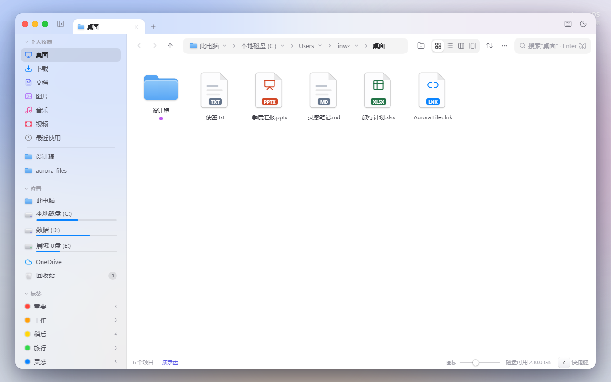
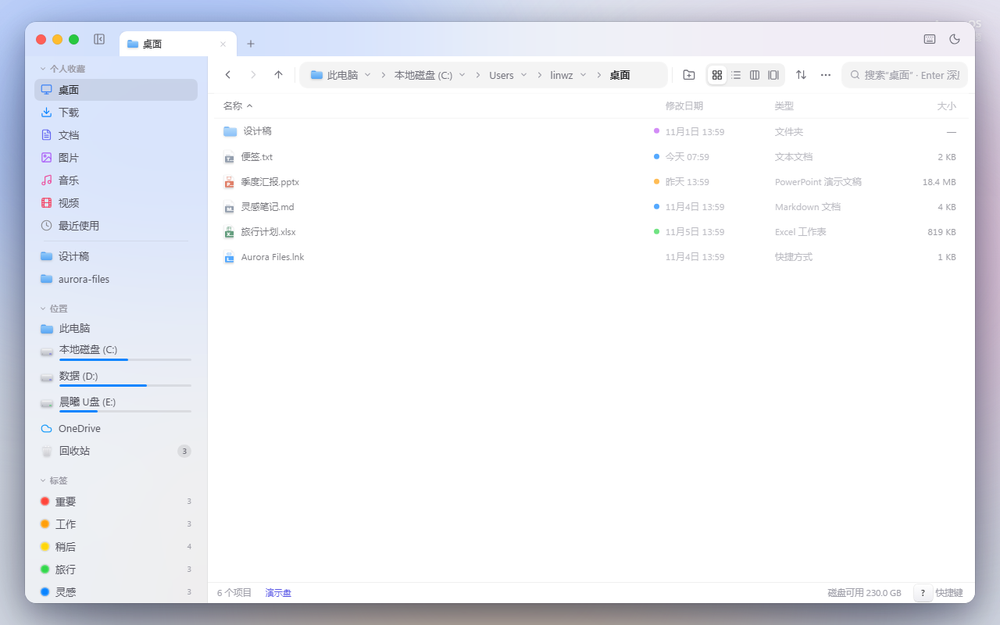
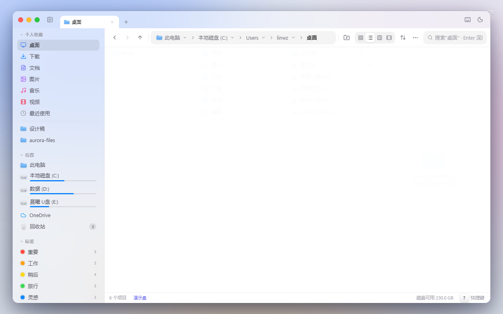
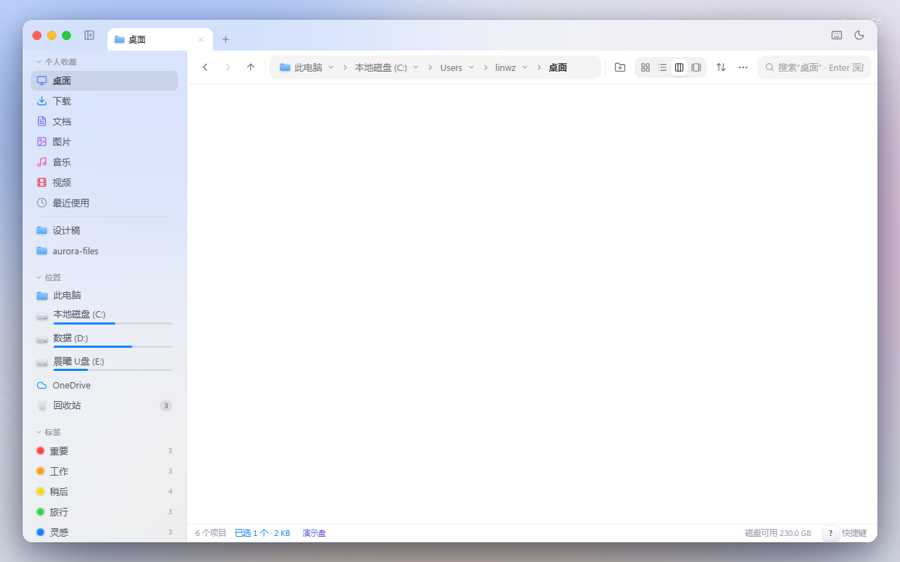
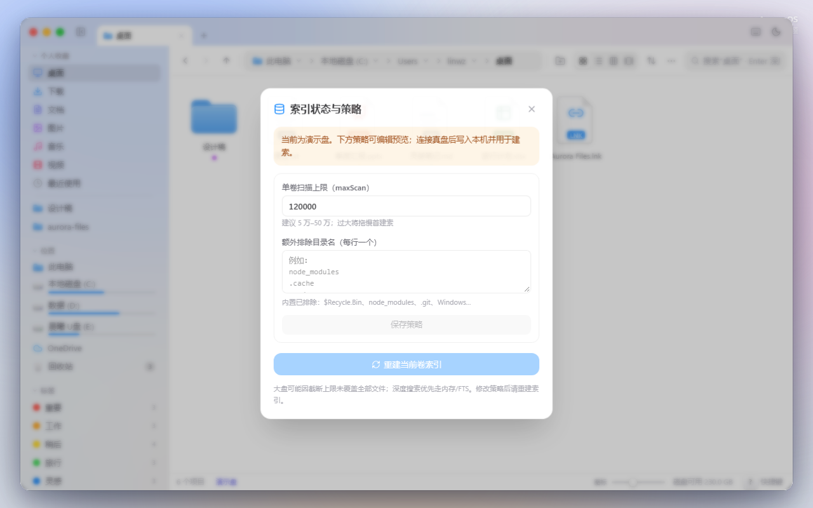
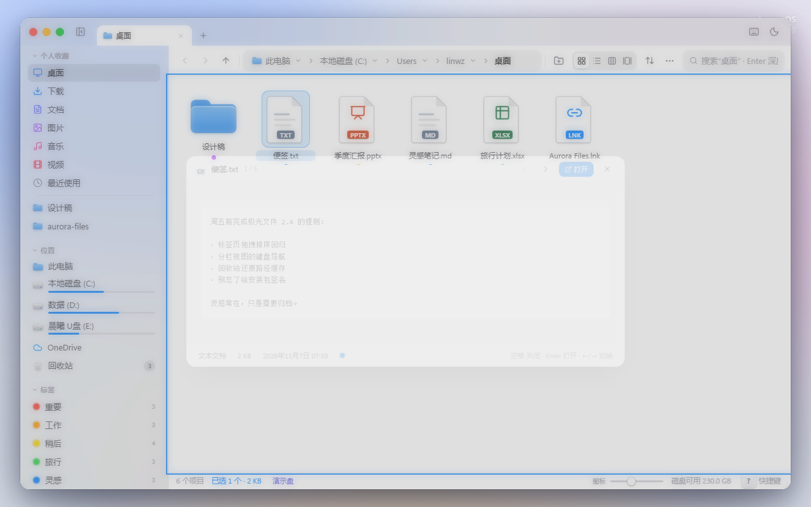

<p align="center">
  
</p>

<h1 align="center">Aurora Files</h1>

<p align="center">
  <strong>An Apple-style file manager for Windows.</strong><br />
  Real-disk browsing · fast search index · rich preview · Finder-inspired UI
</p>

<p align="center">
  <a href="https://github.com/skylinezhanghan-wq/AuroraFiles/actions/workflows/ci.yml"></a>
  <a href="https://github.com/skylinezhanghan-wq/AuroraFiles/releases"></a>
  <a href="LICENSE"></a>
  <a href="https://github.com/skylinezhanghan-wq/AuroraFiles/releases"></a>
</p>

<p align="center">
  <a href="#install">Install</a> ·
  <a href="#features">Features</a> ·
  <a href="#development">Development</a> ·
  <a href="#documentation">Docs</a> ·
  <a href="https://github.com/skylinezhanghan-wq/AuroraFiles/releases">Releases</a>
</p>

---

Aurora Files is a desktop file manager for **Windows x64**, built with Electron + React. It talks to the real filesystem (not a toy sandbox), keeps a volume search index in the background, and aims for the calm density of Finder — tabs, Quick Look, gallery, and a command palette.

> Prefer trying the UI in a browser first? `npm run dev` loads a **demo disk**. The desktop app (`npm run desktop`) is the real thing.

**Canonical repo:** [skylinezhanghan-wq/AuroraFiles](https://github.com/skylinezhanghan-wq/AuroraFiles). Desktop builds from **v0.1.5** are Authenticode-signed as **CN=skyline019** (self-issued certificate).

## Screenshots

| Grid | List |
|:---:|:---:|
|  |  |

| Columns | Gallery |
|:---:|:---:|
|  |  |

| Index prefs | Quick Look |
|:---:|:---:|
|  |  |

## Install

Grab the latest build from [Releases](https://github.com/skylinezhanghan-wq/AuroraFiles/releases):

| Artifact | What it is |
|---|---|
| `AuroraFiles-Setup-*.exe` | NSIS installer (~148 MB, includes ffmpeg); signed `CN=skyline019` |
| `AuroraFiles-Portable-*.exe` | Portable; signed `CN=skyline019` |

SmartScreen may still warn on first run — the cert is self-issued, not an EV commercial identity. Release notes: [v0.1.5](docs/RELEASE_NOTES_v0.1.5.md).

## Features

- **Real disk** — drives, Libraries-style folders, copy / cut / paste / rename / Recycle Bin
- **Four views** — grid, list, columns, gallery (files-only toggle)
- **Search** — cancelable deep search over a resident / FTS-backed index
- **Dual-track indexing** — **UI** track keeps the shell responsive while building; **Perf** track is for throughput benches ([details](docs/index-tracks.md))
- **Preview** — images (JPEG/PNG/WebP/BMP + HEIC/TIFF/AVIF/RAW via bundled ffmpeg), video posters, DOCX / XLSX, PPTX slide canvas; CJK paths supported ([details](docs/preview-media.md))
- **Desktop UX** — tabs, Quick Look (`Space`), command palette, dark mode, index strategy panel

## Development

Requires **Node 22+** and Windows for the full desktop path.

```bash
git clone https://github.com/skylinezhanghan-wq/AuroraFiles.git
cd AuroraFiles
npm ci
npm run ffmpeg:ensure   # download bundled ffmpeg if missing
npm run desktop         # Electron + Vite HMR (real disk)
# npm run dev           # browser demo disk only
```

### Common scripts

| Command | Purpose |
|---|---|
| `npm test` | Vitest |
| `npm run test:e2e` | Playwright |
| `npm run test:e2e:full-gui` | Full GUI screenshots + video |
| `npm run test:perf-startup` | Cold-start gates |
| `npm run test:perf-volume` | Volume index (Perf track) |
| `npm run native:indexd` | Build Rust `aurora-indexd` |
| `npm run build:desktop` | Unsigned NSIS + portable |
| `npm run build:desktop:signed` | Signed pack (`CSC_LINK` + `CSC_KEY_PASSWORD`) |

Packaging, updater, and smoke gates: [`docs/RELEASE.md`](docs/RELEASE.md).

### ffmpeg

Desktop media decode ships **ffmpeg-static** (GPL). Install policy is **mirror XOR proxy** — never both:

```bash
npm run ffmpeg:ensure
# FFMPEG_FETCH=proxy HTTPS_PROXY=http://127.0.0.1:10808 npm run ffmpeg:ensure
```

Packaged binary lands at `resources/ffmpeg/ffmpeg.exe`.

## Architecture

```
src/        React UI + Zustand
electron/   Main process · FS IPC · index · media · updater
shared/     aurora-file URL + MIME (main + renderer)
native/     aurora-indexd · walk-bench · mft-enum
e2e/        Playwright
docs/       Specs · ledger · release notes
```

Index stack: Electron orchestrator → optional [`aurora-indexd`](docs/indexd-resident.md) → WalkEngine (`mft → rust → js`) → FTS5 sidecar → hydrate-first reopen. Everyday builds use the **UI** index track; volume benches use **Perf**.

## Documentation

| Doc | Topic |
|---|---|
| [docs/README.md](docs/README.md) | Doc index |
| [docs/index-tracks.md](docs/index-tracks.md) | UI / Perf indexing tracks |
| [docs/preview-media.md](docs/preview-media.md) | Preview pipeline & CJK paths |
| [docs/indexd-resident.md](docs/indexd-resident.md) | Resident Rust index |
| [docs/perf-ledger.md](docs/perf-ledger.md) | Optimization ledger |
| [docs/RELEASE.md](docs/RELEASE.md) | Build & release |

## CI

[`.github/workflows/ci.yml`](.github/workflows/ci.yml):

1. **test** (Ubuntu) — typecheck, unit, index bench, renderer builds  
2. **windows-gate** — typecheck, unit, real-disk search, Playwright  
3. **package-win** (`main`) — unsigned desktop package + smoke artifact  

PRs need `test` + `windows-gate` green. Latest green run on this repo: Actions → CI.

## Contributing

Issues and PRs are welcome on **[skylinezhanghan-wq/AuroraFiles](https://github.com/skylinezhanghan-wq/AuroraFiles)**. Please keep changes focused, run `npm test` (and Windows e2e when touching shell / index / preview), and prefer linking perf claims to `docs/perf-ledger.md` or a `perf-out/` run id.

## License

[MIT](LICENSE) © 2026 [skylinezhanghan-wq](https://github.com/skylinezhanghan-wq)

Desktop builds also redistribute **Electron/Chromium** and **ffmpeg-static** (GPL). If you redistribute binaries, follow their terms. Release binaries are code-signed as **CN=skyline019**.
