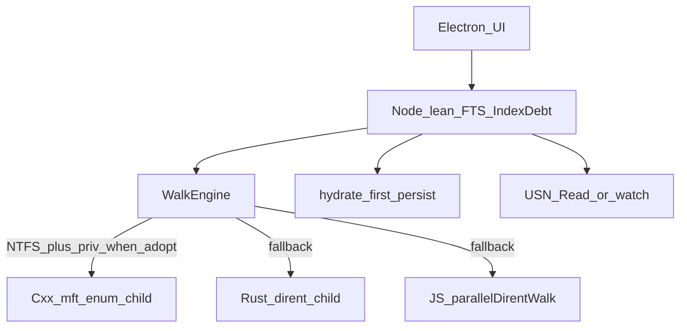

# Bakeoff: JS / Rust / C++ MFT / USN

Run: `npm run test:perf-bakeoff -- --volume E:\`  
Artifacts: `perf-out/bakeoff-*/summary.json`, sticky `perf-out/bakeoff-verdict.json`.

Product indexing uses **UI / Perf tracks** (see [`index-tracks.md`](./index-tracks.md)). Bakeoff engines (mft/rust/js) are selected by WalkEngine + verdict; track knobs only affect Node-side concurrency / debt when the JS walk path runs.

## Same-machine results (E:\\ ~1.10M, 2026-11-07)

| Engine | Mode | Count | ms | entries/s | RSS MB | Notes |
|---|---|---:|---:|---:|---:|---|
| JS | count | 1,098,590 | 8,433 | 130,273 | 209.8 | |
| JS | store | 1,097,786 | 8,342 | 131,597 | 310.7 | |
| Rust | count | 1,098,969 | 5,363 | 204,917 | 10.7 | |
| Rust | store | 1,098,969 | 5,395 | 203,701 | **15.3** | |
| Rust | compact | 1,098,969 | 5,350 | — | 11.2 | |
| USN Enum PS | enum | — | 591 | — | — | `skipped_no_priv` |
| **C++ MFT** | count | — | 0 | — | 4.1 | `skipped_no_priv` |
| **C++ MFT** | store | — | 0 | — | — | `skipped_no_priv` |

### Elevated (Admin + SeBackup) — `bakeoff-2026-11-07T01-51-06-129Z`

| Engine | Mode | Count | ms | entries/s | RSS MB | Notes |
|---|---|---:|---:|---:|---:|---|
| JS | store | 1,100,180 | 20,146 | 54,610 | 301 | |
| Rust | store | 1,115,765 | 14,051 | 79,408 | **15.7** | |
| USN Enum PS | enum | 1,098,428 | 20,452 | 53,708 | — | ok |
| **C++ MFT** | count | 1,098,429 | 5,570 | 197,217 | — | FRN mask + root#5 |
| **C++ MFT** | store | **1,098,423** | **5,602** | **196,092** | — | path cache; orphans≈0 |

## Verdict

| Gate | Result |
|---|---|
| Rust store | **adopt** |
| C++ MFT store (≥150k/s or ≤10s, ≥100k paths) | **adopt** (elevated) |
| Engine priority today | **`mft → rust → js`** when Admin; else `rust → js` |

Fixes that unblocked MFT paths: FRN 48-bit index mask; NTFS root FRN=5 when enum omits root; parent-path memoization.

## Optimal combination (locked)

**Electron UI + Node lean/FTS/debt + WalkEngine (`mft → rust → js`) + hydrate-first + USN/watch；C++ MFT 过线才默认启用。**



### Innovation vs Everything

1. **MFT-Seed → Debt** — C++ streams `{path,name,kind,frn}`; Node lean upsert + FTS valley drip (not a monolithic MFT mirror UX).
2. **FRN from cold scan** — MFT path fills `frnMap` for USN softRefresh (Dirent lean left frn cold).
3. **Silent fallback** — `mft_no_priv` → rust (verified) → js; no crash.
4. **Hydrate-first second open** — still preferred over re-enum every launch.

### Binaries

| Tool | Path | Build |
|---|---|---|
| Rust walk | `native/walk-bench/target/release/aurora-walk-bench.exe` | `npm run native:walk-bench` |
| C++ MFT | `native/mft-enum/build/Release/aurora-mft-enum.exe` | `npm run native:mft-enum` |

Env: `AURORA_WALK_ENGINE=mft|rust|js`, `AURORA_MFT_BIN=…`, `AURORA_WALK_BIN=…`.

C++ self-test (no privilege): `aurora-mft-enum.exe --self-test`.

### Elevated re-bake (when available)

```bash
# Admin shell
npm run test:perf-bakeoff -- --volume E:\
# Expect mft=adopt if store eps>=250k/s or ms<=5000 with paths
```

## Commands

```bash
npm run native:mft-enum
npm run native:walk-bench
npm run test:perf-bakeoff -- --volume E:\
npm run test:perf-hydrate
```
