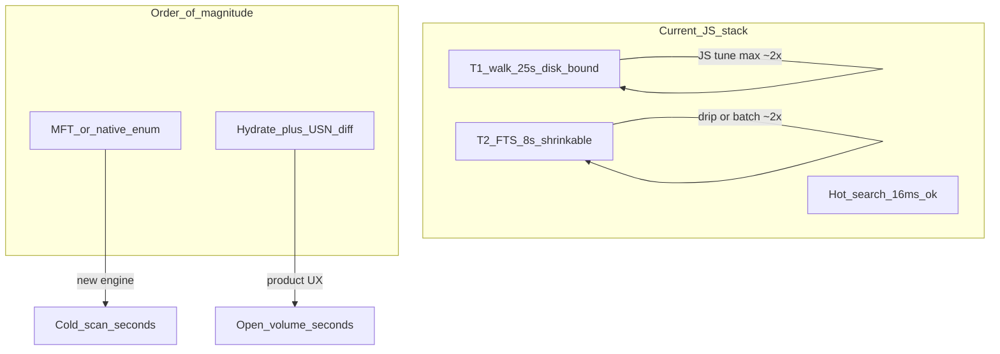

# Research: 秒级卷扫与 Diff 高速命中

> 工程轨已落地：lean + IndexDebt 错峰清偿 + 深路径 `\\?\`。本笔记固定研究结论与产品口径。

## 秒级卷扫（Cold scan）

| 路线 | 结论 |
|---|---|
| 并行 Dirent（现状） | E:\ ~110 万 / ~40s 量级（~2.5万+/s）。榨干 JS `readdir` **难到秒级冷扫**。 |
| lean+记债 | 不提升枚举上限；把「可搜时刻」与「债清完」分离，削封口 RSS/IO 尖峰。 |
| USN Enum / MFT | Bakeoff：无特权 → **mft=defer**。过门槛前不进默认引擎；见 `docs/bakeoff-engine.md`。 |
| Rust walk child | 同机 store **~1.56× 吞吐、~0.05× RSS** → **rust_walk=adopt**；WalkEngine 流式接入，Electron 壳保留。 |
| **产品秒级定义（采用）** | **二次打开 = 磁盘 hydrate（秒级体感）+ USN/脏目录 diff + 错峰还债**；首次冷扫可后台。 |

## Diff 高速命中

| 现状 | 含义 |
|---|---|
| `softRefresh` = ReadUsn(FRN) + 脏目录 | 形状正确 |
| Dirent 快扫不 `stat` → `frnSize` 接近 0 | USN 难映射 path |
| 对策 | **`debt.frn` 懒补齐**（空闲切片 / USN 命中时补）；禁止为 FRN 全量阻塞冷扫 |
| 基准 | `node scripts/perf/measure-diff.mjs`（小树 + `frnDebt:'sync'`） |

高速命中验收（有 USN 权限时，后续）：K=100，`softRefresh` p95 &lt; 50ms、漏检 0。无权限时脏目录路径仍正确。

## 与记债错峰的关系

```
冷扫热路径 → meta+byName（可搜）
         → owe(fts, frn, persist)
错峰切片 → FTS 事务流 → 可搜召回增强
         → FRN 涓流 → diff 命中变热
         → persist 延后 → 无 JSON 尖峰
```

## T1 工作节奏（CPU / I/O 峰谷）与谷期还债

数据来源：`volume-2026-11-06T23-31-42-731Z` E:\\ 高压 lean（progress 约每 3s）。

| 时段 (s) | 扫描速率 (entries/s) | 解读 |
|---|---|---|
| 0–3 | **~104k** | 峰：浅层/热目录，readdir 快，CPU 吃 upsert |
| 3–6 | ~48k | 回落 |
| 6–9 | **~27k** | 谷：深树/冷页/杀软 |
| 9–12 | ~33k | |
| 12–16 | **~20k** | **最深谷** |
| 16–19 | ~29k | |
| 19–22 | ~56k | 峰回升 |
| 24 | T1 可搜 | 随后 T2 纯还 FTS 债 ~10s |

**结论**

1. T1 不是匀速：峰谷差约 **5×**（20k vs 104k）。谷期多半是 **libuv 等磁盘**，JS 线程相对空。
2. 当前 FTS 债 **整段落在 T1 之后**（T2≈10s），与「谷期空转」叠床架屋。
3. **可在谷期涓流还 `debt.fts`**：仅当瞬时速率低于阈值（如 &lt;35k/s）时 `paySlice` 小批 INSERT；峰期不抢 CPU。目标：缩短 T2，尽量不拉长 T1。
4. 风险：谷判误伤（瞬时抖）→ 用窗口速率 + 冷却；SQLite 与 walk 同线程，必须小 `ops`（数百档）。
5. 实现开关：`dripFtsDuringWalk`（lean 默认开）；相位记 `t1_drip_paid`。

### 实验

| 跑次 | T1 drip | T1 | T2 | 总 index | 备注 |
|---|---|---|---|---|---|
| 无涓流 | 0 | ~24.5s | ~10.5s | ~35.5s | 基线 |
| 保守 35k/500（有 bug） | 2.1万 | 24.9s | 8.5s | 33.8s | 早期 |
| **修复空 meta clear + 50k/2k 自适应** `23-45-42` | **14.0万 (~13%)** | **24.7s** | **~8.6s** | **33.7s** | idle+valley 同步涓流 |

**Bug**：开扫 `meta.size===0` 时 idle 回调 `payFts` 会 `0>=0` 误 clear 债 → 整段 T1 涓流为 0。已修：空 meta 直接 return。

**解读**：谷期还债成立；修复后 T1 可消化约一成 FTS 且不拉长可搜时刻。继续加 ops/降阈值可再吃谷，注意峰期 CPU。

## 是否到极限？能否再优化一个数量级（×10）？

数据锚点：
- 优化中期：T1 ~25s / 均速 ~4.4 万/s
- **现栈极限 maxPerf（`00-00-19`）**：T1 **~10.2s** / 全量+FTS **~18.4s** / 热搜 ~21ms（队列去 shift + FTS 游标 + 涓流修正）

| 环节 | 距「本地极限」 | ×10 是否可能 | 说明 |
|---|---|---|---|
| **T1 目录枚举（Node readdir）** | **接近软顶** | **否（本栈）** | 峰已 10 万/s，均速被谷/磁盘绑住；再抠 JS 乐观 **1.5–3×**，到不了 44 万/s（×10 冷扫）。 |
| **T1 若换 MFT/USN Enum / 原生 FindFirst** | 远未做 | **有条件可能** | Everything 类靠卷元数据；可能把**首次建索**打进数秒～十几秒，但是**换引擎**，不是现算法再调参。 |
| **T2 FTS 写入** | 未到顶 | **局部可以 ×2–5，难 ×10 总时长** | 已涓流 ~13%；再吃谷/更大 batch/FTS5 可再削 T2；即使 T2→0，总 index 仍被 T1≈25s 卡住，总时长 **×10 不可能**。 |
| **热搜** | 实用已够 | **无必要** | 16ms→1.6ms 用户无感；瓶颈不在此。 |
| **常驻 RSS（现 ~0.37GB，原 ~0.6–0.8GB）** | **接近 meta 下界** | 再 ×2 难、×10 否 | 已：键路径合一 + lean 弃 byName + name 池；剩余主因是百万 path 字符串+Map；再降需 FTS-only/外置 mmap（无全量 JS meta）。 |
| **二次打开 / diff（产品秒级）** | **主战场仍开放** | **体感可 ×10** | hydrate+USN 相对「每次全量 25s 冷扫」就是数量级；这是口径上的 ×10，不是 T1 walk ×10。 |



### 总判

1. **现栈极限拉扯后**：同卷 T1 25s→**10s**、总建索 34s→**18s**（约 **2×**），符合「常数倍」预判；再往下收益更薄，**不是一个数量级**。
2. **若「再快一个数量级」指首次整卷冷扫**：必须换 **MFT/USN 枚举或原生枚举**（研究轨 C1b/C1d），并过深路径矩阵；投入大、权限/正确性风险高。
3. **若指用户体感**：把「秒级」钉在 **二次打开 + diff**，相对每次 25s 全量扫，**已经是数量级策略**；工程上继续压 hydrate/USN 命中比继续榨 T1 更划算。
4. **建议**：T1 只做低成本收尾（drip 调参、少分配）；**不承诺** JS walk ×10；若要冷扫 ×10，单独立项原生/MFT 并先做微基准门槛（同卷对比现 4.4 万/s）。

## MFT / USN Enum / 原生枚举 — 代价评估

对照基线：现栈 T1 ~25s / ~110 万（~4.4 万/s），已有 `queryUsnJournal` + PowerShell `ReadUsn`（需提升权限，失败走 watch）。仓库**无** napi/node-gyp 原生附件。

### 三条技术路线

| 路线 | 机制 | 预期相对 T1 | 主要约束 |
|---|---|---|---|
| **A. USN Enum（`FSCTL_ENUM_USN_DATA`）** | 按序吐 MFT 记录：FRN、父 FRN、文件名 | 常有机会 **数秒～十几秒** 量级（视盘与实现） | **仅 NTFS**；要自己 **FRN→路径拼树**；需卷句柄权限 |
| **B. 原生 `FindFirstFileExW` / 线程池** | 仍是目录树，但无 JS 编组、可多线程 | 多见 **2–5×**，难稳到 ×10 | 仍吃目录布局与杀软；深路径 `\\?\` 要自己管 |
| **C. 加强现有 ReadUsn + 持久索引** | 不做全量 Enum；首次可慢，之后 hydrate+diff | **二次打开秒级**；冷扫不 ×10 | 与现架构连续；权限失败已有降级 |

### 代价分解（相对收益）

| 成本维 | A USN Enum | B 原生 FindFirst | C 强化 hydrate/USN diff |
|---|---|---|---|
| **工程量** | 高：C/Rust-napi 或扩现有 PS/C# P/Invoke；路径重建+硬链接/重解析；与 lean/债/FTS 对接 | 中高：addon + 打包矩阵（Electron ABI） | **低～中**：落盘格式、FRN 命中、PS→原生 ReadUsn 可选 |
| **权限 / 安全** | 打开 `\\.\X:` 常要 **Admin / SeBackupPrivilege**；商店/普通用户路径差 | 一般用户即可 | 与现 USN 相同；无权限则 watch |
| **正确性** | 拼路径错误 → 搜到幽灵路径；联接/硬链接/删除竞争；**深路径矩阵必须全过** | 与现 walk 同构，风险较低 | 路径仍来自 FS API，风险最低 |
| **平台** | Win+NTFS；ReFS/网络盘/exFAT **要回退 Dirent** | Win 为主 | 已有回退 |
| **运维** | 原生崩溃=整进程；CI 要 Windows 真机基准 | 同左 | 维持 JS 为主 |
| **与现债模型** | Enum 产出仍要灌 meta/FTS；可保留错峰债 | 可替换 `parallelDirentWalk` 内核 | 直接增强 T1 之后路径 |
| **预估人力** | **3–8 人周** 到可 A/B（含权限 UX、回退、深路径） | **2–5 人周** | **1–3 人周** 打磨秒级打开 |
| **预估加速（冷扫）** | 目标区 **5–15×**（达门槛才立项） | **2–5×** | 冷扫不变；**打开体感 ×10** |

### 隐性成本（常被低估）

1. **权限产品化**：首次弹 UAC / 「以管理员索引」分流；无权限必须静默回退现 walk，两套代码长期并存。
2. **路径重建**：Enum 只给 (frn, parentFrn, name)；要建 FRN 地图、处理孤儿、与 `$Extend` 等系统项；和当前「Dirent 即路径」心智不同。
3. **双引擎测试**：每个 perf 剖面 × {Dirent, Enum}；深路径 D1–D7、隐藏、联接都要双跑。
4. **Electron 发布**：native addon 按 Electron 版本重建；当前零原生依赖，引入后 CI/发布链变重。
5. **现有 PS USN**：已证明「能读但重、要提权」；Enum 全量比 ReadUsn 增量 **更重权限与实现**，不能假设「已有 usn-read.ps1 就能白嫖 Enum」。

### 门槛建议（未达标不立项 A/B）

同机 E:\\（或固定样本卷）微基准：

1. **枚举+拼出逻辑路径** 吞吐 ≥ **25 万 entries/s**（约现均速 ×5），或全量可搜索引 ≤ **5s**（现 ~25s T1）。
2. 深路径矩阵 D1–D7 **零失败**；无 Admin 时自动回退且无崩溃。
3. 内存峰值 ≤ 现 lean T1（~0.75GB）或不劣于 +20%。

达不到 → 维持 Dirent；把人力投 **C（hydrate + USN/脏目录命中）**。

### 推荐立场

| 目标 | 建议 |
|---|---|
| 用户感到「秒级」 | **优先 C**，代价最小、与现栈连续 |
| 证明冷扫也能 ×5+ | **先做 A 的只读微基准**（可临时 C#/PS，不进产品），过门槛再谈 napi |
| 只想少改架构再快一点 | **B 性价比一般**（仍目录 walk）；不如 C，也不如达标后的 A |

**一句话**：MFT/USN Enum 是唯一现实的「冷扫数量级」候选人，但 **权限 + 路径重建 + 原生交付** 代价高；未过同卷微基准前不应进主线。原生 FindFirst 多半只换常数倍。产品数量级应继续押 **持久索引 + diff**。

## 最优组合（MFT+C++ 融合后锁定）

**Electron UI + Node lean/FTS/debt + WalkEngine(`mft→rust→js`) + hydrate-first + USN/watch；C++ MFT 过门槛才默认。**

工程分轨（2026-11-07 起）：产品默认 **UI 轨**（保交互）；体积/吞吐基准 **Perf 轨**（`maxPerf`）。见 [`index-tracks.md`](./index-tracks.md)。勿用 UI 轨结果与历史 maxPerf 账本直接对比。

- C++：`native/mft-enum`（ENUM_USN_DATA + FRN→路径 + NDJSON/`frn`）。
- 走盘：`electron/index/walkEngine.mjs`；无特权静默 rust；`mft=adopt` 后卷根优先 MFT。
- 创新：MFT-Seed→Debt、冷扫带 FRN 喂 USN、hydrate 秒开（非每次 MFT）。
- 证据：`docs/bakeoff-engine.md`、`npm run test:perf-bakeoff` / `native:mft-enum`。
